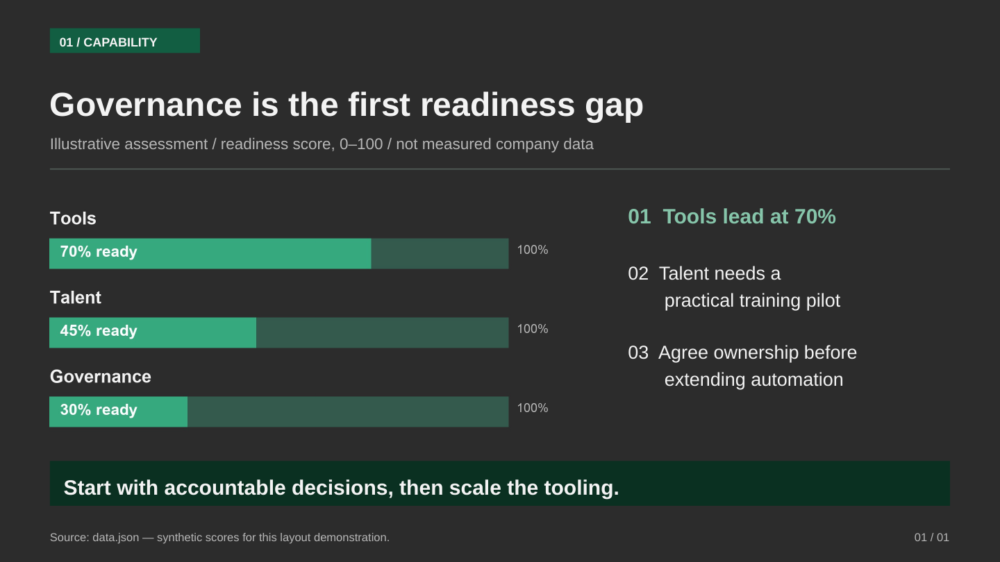
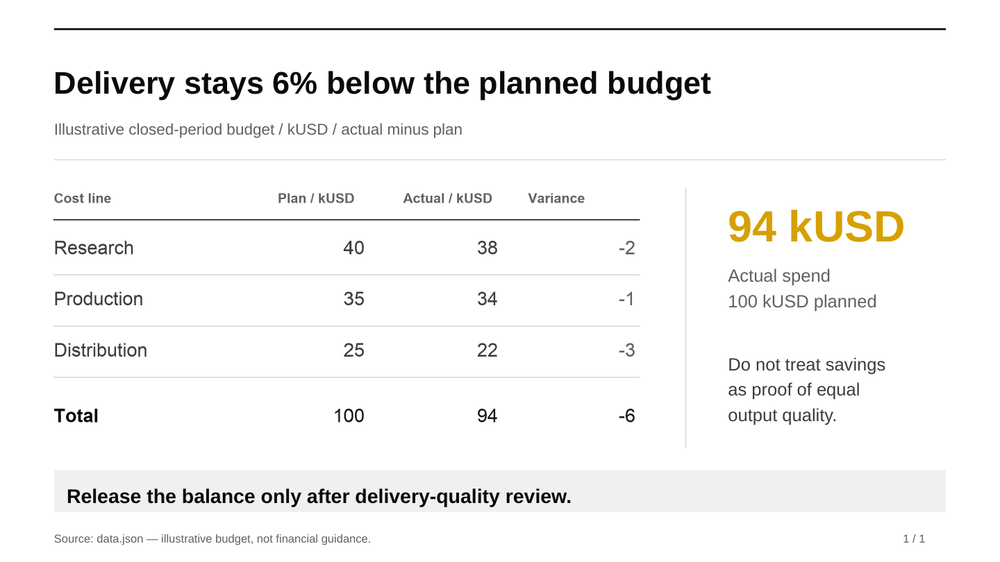
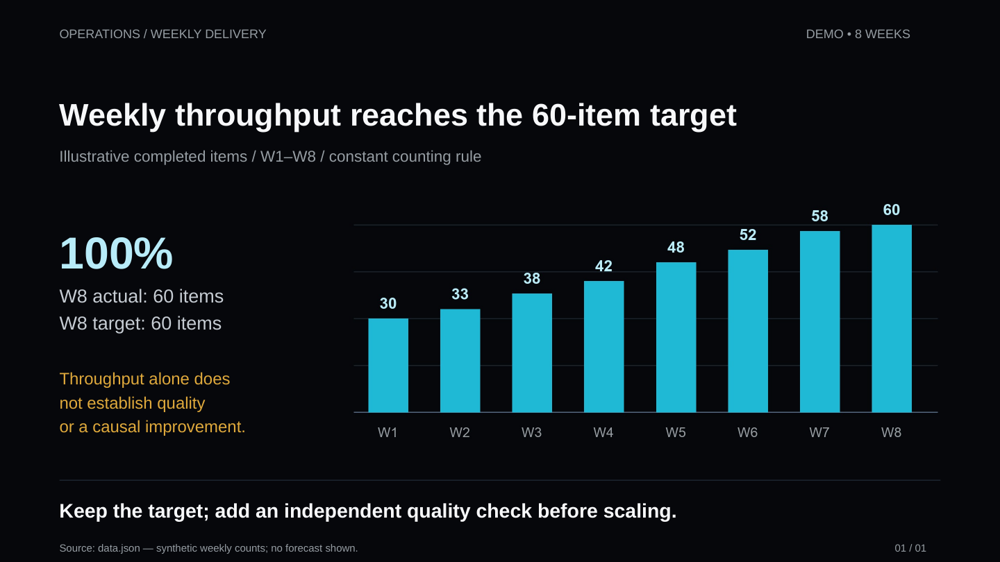
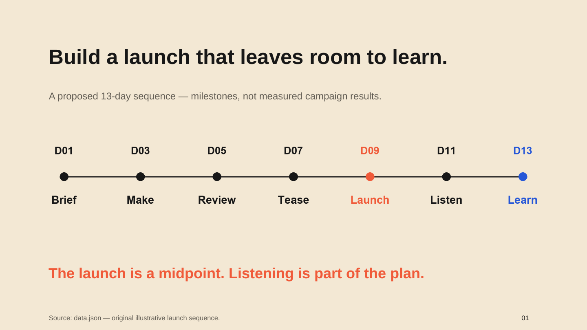
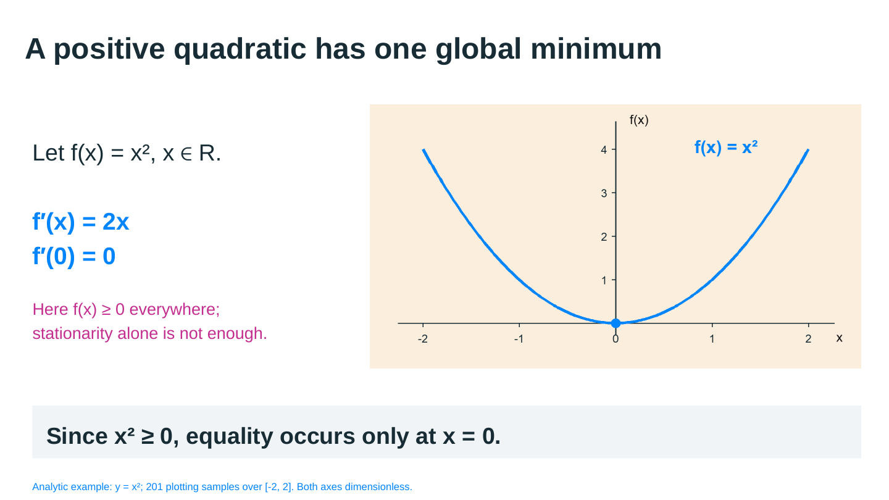

# ansatz-slide

`ansatz-slide` 是一个非官方的演示文稿 Skill 和命令行工具。它使用 PPTD v2 描述页面，通过随包分发的本地 WASM 写入器生成 PPTX，并提供严格校验、单页增量替换和本地浏览器编辑器。

本项目的主要方向是 **PPTD → PPTX**。它不把任意 PPTX 反向还原为 PPTD，也不把“文件成功生成”等同于“视觉效果已经通过”。

> 本项目包含第三方兼容编辑器与预编译写入器。支持范围以严格校验器和实际导出验证为准，不承诺任意 OOXML 功能的完整兼容。

## 核心能力

- 校验完整 PPTD 项目，在写文件前拒绝已知会丢失或错误表达语义的 DSL。
- 使用包内 WASM 将 PPTD 导出为原生 PPTX；核心导出不需要浏览器、Python、登录凭据或在线导出 API。
- 只替换已有 PPTX 的指定页面，并验证其他页面及其关联资源保持 OOXML 语义一致。
- 在 `127.0.0.1` 提供本地 PPTD 编辑器，用于查看、编辑和手动导出。
- 可选地复用系统 Chrome、Chromium 或 Edge 渲染页面，供视觉模型或人工进行质检。

## 素材原则

`ansatz-slide` 负责演示文稿的版式编排，不负责凭空制造事实素材。

- 照片、插画、复杂图表和成品表格应由用户提供，或由专门的检索、绘图和数据工具生成。
- PPTD 负责素材的位置、尺寸、裁切、标题、标注和来源。
- 没有合格素材时，应保留明确标注的占位框，不得静默插入无关、错误或无法确认真实性的图片。
- 远程图片会在导出时读取；本地图片必须位于 PPTD 项目目录内。缺失或读取失败会中止导出。
- `example/` 应当展示当前 Skill 的真实工作方式，而不是照搬参考稿。每个公开示例必须同时保留可执行 PPTD、真实或明确授权的素材、实际导出的 PPTX、渲染结果和验证记录。

## 实际生成的示范

下面五页是新编写的示范，不是参考 PPT 的复制品。每个目录都保留 `deck.pptd`、`pages/01.page`、`media/evidence.png`、数据与来源说明、`demo.pptx` 和实际 PPTX 渲染的 `preview.png`。业务数字明确标为示例数据，学术图使用解析函数。

图、表由外部脚本生成；PPTD 只负责排版与原生文字。点击项目查看可修改源文件，点击 PPTX 下载实际输出。

| 场景 / 风格 | 示范内容 | 文件 |
| --- | --- | --- |
| 咨询 / moss-green-transformation | 就绪度条形证据 + 编号解释 + 决策结论 | [项目](example/verified-styles/moss-green-transformation) · [PPTX](example/verified-styles/moss-green-transformation/demo.pptx) |
| 财务 / black-gold-ledger | 外部预算表格 + 单一金色 KPI + 口径与限制 | [项目](example/verified-styles/black-gold-ledger) · [PPTX](example/verified-styles/black-gold-ledger/demo.pptx) |
| 工作汇报 / blue-flame-brand | 8 周趋势图 + 目标/实际 + 质量警示 | [项目](example/verified-styles/blue-flame-brand) · [PPTX](example/verified-styles/blue-flame-brand/demo.pptx) |
| 推广 / cream-collage | 7 节点活动节奏 + 发布后的反馈阶段 | [项目](example/verified-styles/cream-collage) · [PPTX](example/verified-styles/cream-collage/demo.pptx) |
| 学术 / pastel-derivation | 解析函数图 + 可编辑公式文字 + 成立条件 | [项目](example/verified-styles/pastel-derivation) · [PPTX](example/verified-styles/pastel-derivation/demo.pptx) |







五份输出已通过严格导出、OOXML 检查及 LibreOffice 渲染后的逐页视觉检查。它们只展示选定的单页版式，不证明所有风格、整套叙事或所有 Office 软件都已验证。Arial 未嵌入；图表/表格 PNG 不可逐数据点或单元格编辑。复现命令、字体适配与验证范围见[验证记录](example/verified-styles/VERIFICATION.md)。其他旧样例不作为当前能力证明。示范资产保留在源码仓库，不增加 npm 安装包体积。

克隆仓库并运行 `npm ci` 后，可直接重导出一个示范，无需浏览器或重绘素材：

```bash
node bin/ansatz-slide.js export example/verified-styles/black-gold-ledger \
  --output example/verified-styles/black-gold-ledger/demo.pptx
```

风格选择见[主题索引](theme.md)。视觉体系与可执行语法分开维护：[运行约束](skills/ansatz-slide/reference/design-system-runtime.md) · [60 份风格文件的选择目录](skills/ansatz-slide/reference/design-system-inventory.md)。旧主题缩略图只表示上游风格参考，不与以上实测预览混淆。

## 安装

核心运行环境要求 Node.js 24 或更高版本。

将 Skill 安装到默认共享目录：

```bash
npx ansatz-slide@1.3.0 install -y
```

交互式选择 Agent 目录：

```bash
npx ansatz-slide@1.3.0 install
```

指定一个或多个 Skill 目录：

```bash
npx ansatz-slide@1.3.0 install \
  --target ~/.codex/skills \
  --target ~/.claude/skills
```

也可以使用 `--all` 安装到已检测到的 Agent 目录。重新运行安装命令会替换已安装的 `ansatz-slide` Skill，但不会修改已有 PPTD 或 PPTX 项目。

安装包包含 PPTX writer WASM、本地编辑器资源和固定版本的 YAML 解析器，不包含 Chromium、PowerPoint、系统字体或 Python 解释器。

## 快速开始

一个最小 PPTD 项目由清单、页面文件和可选素材目录组成：

```text
deck/
├── deck.pptd
├── pages/
│   └── 01.page
└── media/
```

`deck/deck.pptd`：

```yaml
version: v2
title: Minimal deck
size: [960, 540]
pages:
  - pages/01.page
```

`deck/pages/01.page`：

```yaml
pageType: content
background: {type: solid, color: "#F7F8FC"}
elements:
  - elementId: title
    elementType: text
    bounds: [100, 180, 760, 120]
    content:
      align: [center, middle]
      fontFamily: Arial
      text: |
        <p><span style="font-size:42px;color:#171923;font-weight:700">Hello, ansatz-slide</span></p>
```

先校验，再导出：

```bash
npx ansatz-slide@1.3.0 validate ./deck
npx ansatz-slide@1.3.0 export ./deck -o ./deck.pptx
```

导出命令默认写入淡入淡出页面切换；可通过 `--transition none` 关闭。

完整 DSL 参考见 [PPTD reference](skills/ansatz-slide/reference/pptd.md)，可执行边界见 [DSL support matrix](docs/DSL_SUPPORT_MATRIX.md)。当文档与实现冲突时，以严格校验器和真实导出结果为准。

## 命令

### 校验项目

```bash
npx ansatz-slide@1.3.0 validate <project-directory|deck.pptd>
```

校验清单、页面、元素、引用、路径、表格、图表和动画约束，不生成 PPTX。

### 导出 PPTX

```bash
npx ansatz-slide@1.3.0 export <project-directory|deck.pptd> \
  -o output.pptx \
  --transition fade
```

导出使用本地 Node + WASM 路径。远程图片仍可能需要网络；本地项目则可完全离线处理。

### 替换单页

```bash
npx ansatz-slide@1.3.0 incremental baseline.pptx ./replacement-deck \
  --page 3 \
  -o updated.pptx
```

该命令只替换第 3 页。写出前会验证非目标页的 slide ID、presentation relationship ID、规范化 slide/rels 语义及递归关联资源没有变化。

这里保证的是 **OOXML 语义一致**，不是整个 ZIP 字节一致。ZIP 时间戳、条目顺序和压缩结果可以不同。增量命令需要系统 Python 3.11 或更高版本，但不需要额外 Python 包。

### 启动本地编辑器

```bash
npx ansatz-slide@1.3.0 serve --open
```

默认地址为 <http://127.0.0.1:55173/>。也可以通过 `--port` 指定端口。

编辑器服务只监听本机回环地址并提供静态资源，不提供 HTTP 写文件接口。浏览器通过用户授权的目录句柄保存 `.pptd` 和 `.page`；文件夹上传回退模式只读。

## 推荐生产流程

1. 确定演示目标、受众、页数和视觉约束。
2. 收集并核实真实文字、数据、图片、图表和来源。
3. 对缺失素材使用明确占位框，不用不确定图片补位。
4. 按页生成 PPTD，并运行 `ansatz-slide validate`。
5. 导出 PPTX，检查 ZIP 与 OOXML 结构。
6. 在目标 Office 环境中检查字体、换行、图形和动画。
7. 需要修改一页时使用 `ansatz-slide incremental`，不要重新生成其他页面。

如果启用视觉质检，还应将每页渲染为图片，由具备视觉能力的模型或人工逐页检查遮挡、出界、变形、对比度、文字溢出和素材真实性。静态截图不能证明动画播放正确。

## DSL 与导出边界

以下是当前实现中最重要的限制：

- `candlestick`、`heatmap`、`treemap`、`sunburst` 和 `sankey` 会被严格拒绝。请使用外部生成的 PNG/SVG，或使用明确占位框。
- 原生 `chart` 和 `table` DSL 是兼容路径，不是默认的生产制图方案。
- `scatter` 和 `bubble` 有原生 OOXML 回归测试，但正式交付仍需在目标 Office 中视觉复核。
- `icon` 在浏览器中可以预览；核心 PPTX 可能只保留私有扩展和普通 fallback 形状。交付图标应使用经过确认的 PNG/SVG。
- 动画 timing、颜色、缩放和 motion path 会写入 OOXML；不同 Office 产品中的播放顺序和节奏仍需分别验证。
- 核心导出器不嵌入字体。PPTX 会保留字体名称和可编辑文本，但不同电脑或 Office 产品可能替换字体并改变换行。
- 没有 PPTD 源项目时，不提供任意 PPTX → PPTD 的无损转换。

完整状态及测试证据入口见 [docs/DSL_SUPPORT_MATRIX.md](docs/DSL_SUPPORT_MATRIX.md)。

## 依赖和分发

核心 npm 包包含：

- CLI 和严格校验器；
- `yaml@2.9.0`；
- patched PPTD-to-PPTX WASM；
- 本地 neo-ppt 编辑器及其浏览器 WASM。

核心 `validate` 和 `export` 不需要 Python 或浏览器。以下能力是可选的：

| 能力 | 额外依赖 |
| --- | --- |
| 单页增量替换 | Python 3.11+，仅标准库 |
| 图片导出和视觉 QA | uv `qa` extra、`agent-browser@0.34.0`、系统 Chrome/Chromium/Edge |
| PowerPoint 原生播放验证 | 用户自己的 PowerPoint 或其他目标 Office 软件 |

项目不会自动安装全局 npm/Python 包，也不会自动下载 Chromium。详细依赖清单见 [docs/DEPENDENCIES.md](docs/DEPENDENCIES.md)。

## 本地开发

### 技能指令与执行流程

Skill 使用[执行约定](skills/ansatz-slide/reference/agent-contract.md)区分事实/权限、视觉偏好和运行时限制，按实际可用工具执行，不绑定某个模型的工具名称或安装目录。普通页面可从[经过真实导出测试的最小 DSL](skills/ansatz-slide/reference/authoring-start.md)开始，按需查询完整格式。

具体操作分别见[命令与环境](skills/ansatz-slide/reference/operations.md)、[单页修改](skills/ansatz-slide/reference/page-edit.md)和[交付检查](skills/ansatz-slide/reference/delivery-checks.md)。优化目标是指令明确、无冲突且可执行；不以跨模型能力对照作为验收条件。

### 开发检查

```bash
npm ci
npm test
npm run pack:check
```

Python 兼容层和 QA：

```bash
TMPDIR="$PWD/tmp/test-tmp" UV_CACHE_DIR="$PWD/tmp/uv-cache" \
  uv run --frozen --extra qa python -m unittest discover \
  -s skills/ansatz-slide/tests -v
```

浏览器 QA 工具只安装在仓库本地：

```bash
npm install --no-save --package-lock=false agent-browser@0.34.0
```

发布前必须确认 npm 包不包含 `docs/NEXT_RUN.md`、`.scripts/`、`.state-machine/`、`tmp/`、缓存、本机绝对路径或未经核实的展示素材。

## License 与商标

本仓库代码采用 [MIT License](LICENSE)。保留原作者版权声明；第三方资源不因项目命名变化而成为本项目原创。
